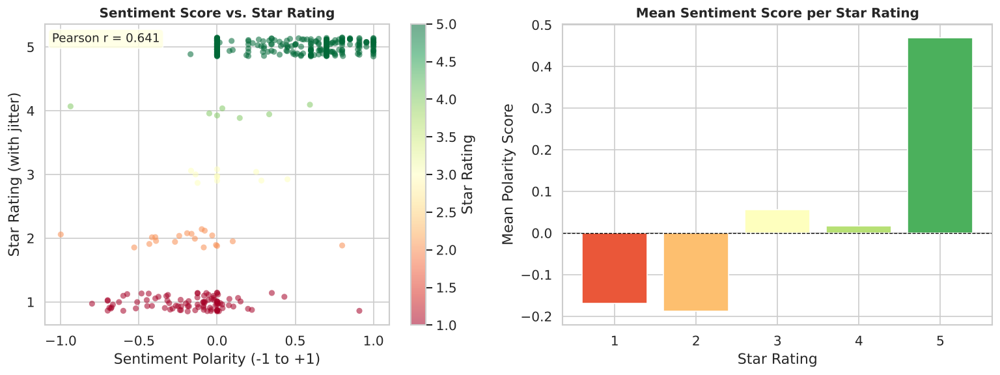
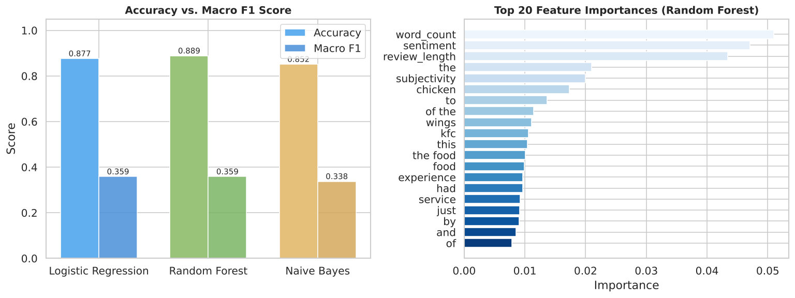
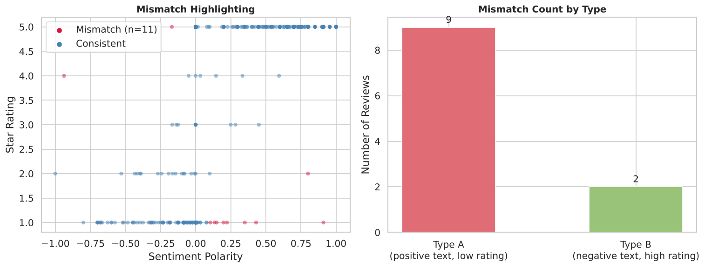

# KFC Trustpilot Reviews – Sentiment vs. Star Rating

Do customers' written reviews actually match the star rating they give? This project scrapes KFC reviews from Trustpilot, scores the text with sentiment analysis, finds reviews where text and rating disagree, and tests whether the star rating can be predicted from the review text.

<p align="center"></p>

## Highlights

- **Own dataset**: scraped with Selenium (Trustpilot renders reviews with JavaScript), March–June 2025
- **Data cleaning**: 480 raw rows → **402 unique reviews** (removed 78 duplicated "featured" reviews and the "See more" suffix on 40 truncated reviews)
- **Sentiment analysis** with TextBlob (polarity + subjectivity) – correlation with star rating: **r = 0.64**
- **Mismatch detection**: 11 reviews (2.7%) where text sentiment contradicts the rating
- **Rating prediction**: TF-IDF (uni- and bigrams) + numeric features, compared Logistic Regression, Random Forest and Naive Bayes, with the vectorizer fitted on the training split only

## Results

| Model | Accuracy | Macro F1 |
|---|---|---|
| Logistic Regression | 0.877 | 0.359 |
| Random Forest | 0.889 | 0.359 |
| Naive Bayes | 0.852 | 0.338 |

<p align="center"></p>
<p align="center"></p>

High accuracy is driven by the dominant 5-star class (68%). Macro F1 shows the models predict 1- and 5-star reviews well but fail on the rare 2–4-star classes.

## Project structure

| File | Description |
|---|---|
| `KFC_TRUSTPILOT.ipynb` | Full analysis: EDA, sentiment, mismatch detection, ML models |
| `scraper_KFC.py` | Selenium scraper used to collect the data |
| `trustpilot_kfc_reviews.csv` | Raw scraped data (cleaned inside the notebook) |
| `images/` | Charts and screenshots used in this README |

## How to run

```bash
pip install -r requirements.txt
python -m textblob.download_corpora
jupyter notebook KFC_TRUSTPILOT.ipynb
```

## Limitations and next steps

- Small, highly imbalanced dataset (only 10 three-star and 7 four-star reviews)
- 40 reviews are truncated by Trustpilot's list view
- TextBlob misses sarcasm and context – a transformer model (e.g. RoBERTa) would be the next step
- Oversampling (SMOTE) and aspect-based sentiment analysis are possible improvements

**Author:** Mehdi Gurbanzade · M.Sc. Data Science
